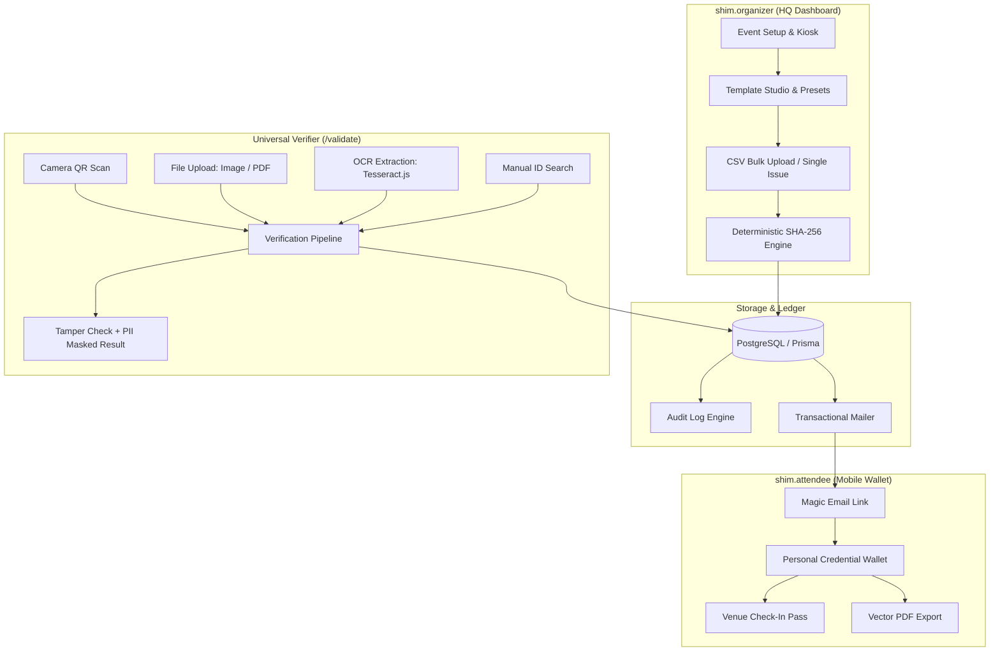

<div align="center">

```
  ██████╗ ██╗  ██╗██╗███╗   ███╗
  ██╔════╝ ██║  ██║██║████╗ ████║
  ███████╗ ███████║██║██╔████╔██║
  ╚════██║ ██╔══██║██║██║╚██╔╝██║
  ██████╔╝ ██║  ██║██║██║ ╚═╝ ██║
  ╚═════╝  ╚═╝  ╚═╝╚═╝╚═╝     ╚═╝
```

### Cryptographic Credential Infrastructure & Attendee Wallet

**Instant tamper verification. Visual design studio. Self-service venue check-in.**

[](https://nextjs.org/)
[](https://react.dev/)
[](https://www.typescriptlang.org/)
[](https://www.prisma.io/)
[](https://www.postgresql.org/)
[](https://tailwindcss.com/)
[](LICENSE)

---

</div>

## 📌 Short Descriptions

Use these copy blocks for project listings, social cards, marketplaces, and submission decks:

* **One-Liner (GitHub About / Tagline — 88 chars):**
  > Cryptographic credential platform with instant verification, drag-and-drop design, and attendee wallets.

* **Micro Bio (Twitter/X / Metadata — 144 chars):**
  > shim automates tamper-proof, QR-verified digital certificates for summits, hackathons, and institutions. Real-time check-in, zero manual work.

* **Elevator Pitch (SaaS / Product Hunt / Overview):**
  > **shim** bridges event operations and verifiable credentials. It replaces fragile manual PDFs with a unified system: organizers design vector credentials in a visual studio, manage live venue check-in kiosks, and batch-issue thousands of certificates cryptographically sealed with deterministic SHA-256 hashes—while attendees receive a dedicated mobile wallet to claim, store, and prove their credentials at the door in sub-second time.

* **Technical Summary (Engineering & Architecture):**
  > A full-stack Next.js 16 / React 19 application backed by PostgreSQL and Prisma ORM, featuring client-side isomorphic SHA-256 certificate fingerprinting, client-side OCR (`tesseract.js`) and PDF canvas extraction (`pdfjs-dist`), multi-channel check-in scanners (`@yudiel/react-qr-scanner`), dynamic vector rendering (`react-rnd`, `jspdf`), NextAuth RBAC, and optional Google Gemini 2.5 Flash curriculum synthesis.

---

## ⚡ What is shim?

Traditional digital certificates are broken: organizers waste hours editing Canva templates, manually mailing PDFs, and reconciling chaotic CSV check-in rosters. Worse, traditional certificates are trivially forged with basic image editors.

**shim** is an institutional-grade credential infrastructure designed with **quiet authority, hairline precision, and zero friction**:

1. **One System, Two Coexisting Surfaces:**
   - **`shim.organizer` (HQ Dashboard):** High-density instrument panel for organizers to orchestrate events, design templates, batch-issue credentials, monitor kiosk attendance, and audit the cryptographic ledger.
   - **`shim.attendee` (Personal Wallet):** Field-optimized mobile passbook built for attendees under venue time pressure. Fast-loading, high-contrast, offline-resilient credential wallet for instant proof at the door.
2. **Cryptographic Integrity by Default:** Every certificate is fingerprinted via a deterministic canonical SHA-256 digest. Any alteration to recipient name, role, date, or event immediately breaks verification.
3. **Privacy-Preserving Public Ledger:** Public verification pages employ automated Personally Identifiable Information (PII) masking (e.g., `j***e@domain.com`), protecting attendee privacy while guaranteeing tamper detection.

---

## 🚀 Key Features

### 🎨 Visual Certificate Studio (`TemplateEditor`)
- **Drag-and-Drop Canvas:** Pixel-accurate element positioning, snapping, resizing, and rotation powered by `react-rnd`.
- **Dynamic Field Injection:** Seamless interpolation of `{{recipientName}}`, `{{role}}`, `{{eventName}}`, `{{issueDate}}`, and `{{certificateId}}`.
- **Curated Typography System:** Built-in web fonts including Inter, Outfit, Cinzel, Cormorant Garamond, Great Vibes, Playfair Display, Space Mono, and Space Grotesk with precise point (`pt`) / pixel (`px`) scale mapping.
- **Brand Assets & Signatures:** Upload high-res institutional crests, vector seals, background watermarks, or sign directly using the embedded canvas signature pad.
- **Prebuilt Aesthetic Presets:** Out-of-the-box templates for Victorian Academic, Corporate Navy, Bauhaus Modern, Luxury Deco, Cyberpunk Tech, and Medical Accreditations.

### ⚡ Batch Issuance & Automated Delivery
- **CSV Ingestion with Auto-Mapping:** Upload hundreds or thousands of attendees; preview sample rows before launching issuance.
- **Single-Click Direct Issuance:** Quick issuance form for immediate ad-hoc credentials.
- **Transactional Email Dispatch:** Automated, branded email delivery via `nodemailer` with magic links for recipients to claim certificates directly into their wallet.
- **High-DPI PDF & PNG Vector Export:** Native client-side PDF generation (`jspdf`, `html2canvas`) preserving crisp vector QR codes and typography.

### 🛡️ Deterministic Cryptographic Fingerprinting & Security
- **Canonical SHA-256 Digest:** Computes an immutable hash over `id`, `recipientName`, `role`, `eventName`, `issueDate`, and `issuerId`.
- **Tamper-Evident Verification:** Instant visual divergence indicator if certificate data has been altered after issuance.
- **PII Obfuscation:** Automatic masking of attendee email addresses on public verification routes to prevent scraping while allowing recipient self-recognition.
- **Status Lifecycle:** Granular status states (`valid`, `revoked`) with immediate real-time revocation updates across all endpoints.

### 🏛️ Venue Operations: Check-in Kiosks & Scanners
- **Live Kiosk Mode (`/kiosk/[id]`):** Fullscreen projector/tablet display showing a dynamic, styled QR code for attendee self-check-in.
- **Direct Check-in Form (`/attend/[id]`):** Frictionless mobile entry where attendees enter their name/email to check in and immediately unlock their digital credential.
- **Staff Scanner (`/scanner/[id]`):** High-speed camera scanner using `@yudiel/react-qr-scanner` for venue staff at the door.

### 📱 Attendee Digital Wallet (`shim.attendee` / `/portal`)
- **Credential Portfolio:** Consolidated overview of all earned accreditations, organized by event and date.
- **Check-in Membership Pass:** Personalized QR pass for one-tap venue check-in across future events.
- **Instant Claim Engine:** Seamlessly links past and future certificates issued to an attendee's verified email address upon sign-in.
- **Export & Print:** High-res vector PDF downloads and print-ready formats.

### 🔍 Universal Multi-Modal Verification (`/validate`)
- **Direct ID Lookup:** Instant search by unique certificate alphanumeric ID.
- **Live Camera Scanner:** Point camera at any paper or screen QR code for sub-second verification.
- **Image & PDF File Inspection:** Upload any PNG, JPG, or PDF certificate.shim extracts embedded QR codes using `jsQR` and parses vector PDF pages using `pdfjs-dist`.
- **Client-Side OCR Fallback:** If the QR code is damaged or unreadable, `tesseract.js` automatically performs optical character recognition to verify text against the ledger.

### 📜 Immutable Audit Trail
- Full chronological tracking of all critical credential events:
  - `ISSUED` — Certificate synthesized and logged to the ledger.
  - `VERIFIED` — Verification scans recorded with IP and timestamp context.
  - `CLAIMED` — Recipient linked credential into their personal wallet.
  - `REVOKED` / `RESTORED` — Administrative state changes audited.

### 🧠 Gemini AI Course Outcome Synthesizer
- Integrated Google Gemini 2.5 Flash (`@google/genai`) to parse academic syllabi and automatically generate accredited course outcomes (COs) mapped to **Bloom's Revised Taxonomy** (Remember, Understand, Apply, Analyze, Evaluate, Create).

---

## 🏛️ System Architecture



---

## 🛠️ Technology Stack

| Layer | Technologies |
| :--- | :--- |
| **Framework** | [Next.js 16](https://nextjs.org/) (App Router, Server Actions, Route Handlers) |
| **Language** | [TypeScript 5](https://www.typescriptlang.org/) (Strict typing throughout) |
| **Frontend & UI** | [React 19](https://react.dev/), [Tailwind CSS](https://tailwindcss.com/), [Framer Motion](https://www.framer.com/motion/), [Lucide React](https://lucide.dev/) |
| **Canvas & Layout** | [`react-rnd`](https://github.com/bokuweb/react-rnd), [`react-draggable`](https://github.com/react-grid-layout/react-draggable), Custom Canvas Renderer |
| **Database & ORM** | [PostgreSQL](https://www.postgresql.org/), [Prisma ORM 5.22](https://www.prisma.io/) |
| **Authentication** | [NextAuth.js v4](https://next-auth.js.org/) (Prisma Adapter, Session & JWT, Credentials & RBAC) |
| **Document Generation** | [`jspdf`](https://github.com/parallax/jsPDF), [`html2canvas`](https://html2canvas.hertzen.com/), [`html-to-image`](https://github.com/bubkoo/html-to-image), [`opentype.js`](https://opentype.js.org/) |
| **QR & Computer Vision** | [`qr-code-styling`](https://github.com/kozakdenys/qr-code-styling), [`qrcode.react`](https://github.com/zpao/qrcode.react), [`@yudiel/react-qr-scanner`](https://github.com/yudiel/react-qr-scanner), [`jsqr`](https://github.com/cozmo/jsQR), [`pdfjs-dist`](https://mozilla.github.io/pdf.js/), [`tesseract.js`](https://tesseract.projectnaptha.com/) |
| **Artificial Intelligence** | [Google GenAI SDK](https://github.com/google-gemini/generative-ai-js) (`@google/genai` / Gemini 2.5 Flash) |
| **Email & Delivery** | [Nodemailer](https://nodemailer.com/) (SMTP with local mock fallback) |
| **CSV & Data** | [PapaParse](https://www.papaparse.com/) |

---

## 🔒 Security & Verification Engine

`shim` enforces zero-trust verification through deterministic hashing:

### 1. The Canonical SHA-256 Fingerprint
When a credential is synthesized, canonical metadata fields are formatted into a deterministic string:
```
id:<CERT_ID>|recipient:<NAME>|role:<ROLE>|event:<EVENT_NAME>|date:<ISO_DATE>|issuer:<ISSUER_ID>
```
The SHA-256 digest of this string represents the certificate's cryptographic seal. On verification:
- The seal is recalculated from canonical database records.
- If any character of the certificate text has been tampered with or falsified, the hash diverges immediately.

### 2. Privacy-First PII Masking
When credentials are queried on public verifier routes (`/validate`), attendee email addresses are automatically obfuscated before leaving the server:
- `john.doe@university.edu` $\rightarrow$ `j***e@university.edu`
- `alex@domain.com` $\rightarrow$ `a***x@domain.com`

This guarantees that public viewers can verify authenticity without allowing scrapers to harvest attendee contact lists.

---

## 📄 License

This project is licensed under the [MIT License](LICENSE).

---

<div align="center">
  <sub>Built with quiet authority and hairline precision by the shim team.</sub>
</div>
